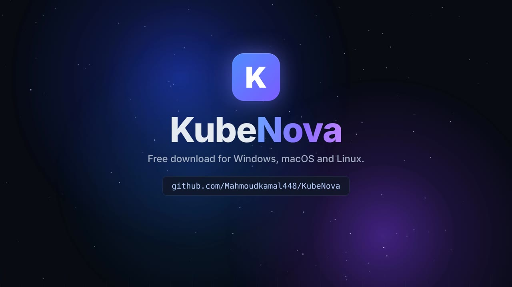

# KubeNova — AI-powered Kubernetes IDE

KubeNova is a cross-platform desktop Kubernetes IDE (Windows, macOS, Linux) in the spirit of Lens. It adds an AI assistant built on Claude and covers enterprise needs. **Every Pro and Enterprise feature is included in the free edition**: team workspaces, RBAC, audit logs, SSO (SAML / OIDC / LDAP / SCIM), air-gapped mode, FIPS builds, and unlimited clusters and seats. Nothing is gated behind a license.

[](docs/video/kubenova.mp4)

▶ **[Watch the 1-minute video](docs/video/kubenova.mp4)**

## Download

**[⬇ Download the latest version](https://github.com/Mahmoudkamal448/KubeNova/releases/latest)**. It's free.

| Platform | File to pick on the download page |
|---|---|
| Windows 10/11 | `KubeNova-Setup-…-win-x64.exe` (installer) or `KubeNova-Portable-…-win-x64.exe` (no install) |
| macOS, Apple Silicon (M1–M4) | `KubeNova-…-mac-arm64.dmg` |
| macOS, Intel | `KubeNova-…-mac-x64.dmg` |
| Linux | `KubeNova-…-linux-x86_64.AppImage`, or `KubeNova-…-linux-amd64.deb` for Ubuntu/Debian |

The builds aren't code-signed yet. On **Windows**, if SmartScreen appears, click **More info → Run anyway**. On **macOS**, right-click the app and choose **Open** the first time; if macOS says the app "is damaged", run `xattr -cr /Applications/KubeNova.app` in Terminal. On **Linux**, make the AppImage executable (`chmod +x KubeNova-*.AppImage`) and run it.

Guides: [Import clusters from Rancher](docs/rancher.md) · [Sync kubeconfig folders](docs/kubeconfig-sync.md)

```
┌────────────── Electron (React + TypeScript) ──────────────┐
│ Clusters · Resources · Monitoring · Helm · GitOps · Security│
│ Topology · Timeline · Compare · Search · Rancher · Cloud    │
│ Toolbox · Extensions · Teams · AI assistant · Terminal dock │
└──────────────┬──────────────── HTTP + WebSocket ────────────┘
               │ 127.0.0.1, random port + per-launch token
┌──────────────▼──────────── Go backend (kubenova-server) ────┐
│ client-go (dynamic + discovery) · SPDY/WS exec & port-fwd   │
│ Helm/Trivy/Kubescape/cloud CLIs · Claude API (Go SDK) · MCP │
└─────────────────────────────────────────────────────────────┘
```

## Features

| Area | What you get |
|---|---|
| **Cluster management** | Unlimited clusters from any number of kubeconfig files (`KUBECONFIG`, `~/.kube/config`, `~/.kube/configs/*`, added files, pasted or imported configs), **synced kubeconfig folders** that pick up added/changed/deleted files automatically ([guide](docs/kubeconfig-sync.md)), merged export, context switching (also updates kubectl's current-context), groups, favorites, search, recents, colours/tags, background health checks with a bounded worker pool (500+ clusters), version + distribution detection (EKS/AKS/GKE/RKE2/K3s/…), API latency, node/pod/capacity overview, client-certificate expiry warnings, and an **offline cache** that keeps the last known resource lists. |
| **Resources** | Discovery-driven: every built-in type, Gateway API, and **any CRD** appear automatically, grouped by section. Tables are virtualized, lazily paginated and kept live by WebSocket watches. |
| **Operations** | Create (templates and AI generation), YAML editing, **server-side dry-run diff**, delete (incl. bulk), scale, rollout restart, rollback (Deployment ReplicaSets, StatefulSet/DaemonSet ControllerRevisions), JSON/merge/strategic/apply patch, clone (across namespaces and clusters), export of clean YAML, client-side apply, **server-side apply**. |
| **Pod tools** | Live and previous logs, multi-pod (label selector, stern-like) and multi-container logs, substring/regex search with highlighting, download, interactive exec shell (xterm.js), file browser with download/upload, port forwarding (pods and services), live metrics, events, environment variables, mounted volumes. |
| **Monitoring** | Metrics Server, Prometheus, Mimir, VictoriaMetrics (PromQL), Loki (LogQL), Tempo (traces), Alertmanager, Grafana proxy. Auto-detects in-cluster services or uses direct URLs/tokens/tenants. CPU, memory, network and filesystem dashboards at cluster, node, namespace and pod level; custom and **AI-generated dashboards**. |
| **Helm** | Releases, values/manifest/notes, history, rollback, uninstall, install/upgrade with a values editor, **diff**, server dry-run, repository management, **OCI registries**, chart search. |
| **GitOps** | FluxCD (Kustomizations, HelmReleases, sources, image policies) and Argo CD (Applications, ApplicationSets): health, sync status, revision, history, drift; reconcile, suspend/resume, sync, hard refresh, rollback; a Flux dependency graph. |
| **Storage & networking** | Every CSI/Longhorn/Rook-Ceph/OpenEBS/NFS/cloud-disk CRD and StorageClass shows up through discovery. The same goes for Ingress NGINX, Traefik, HAProxy, Gateway API, Istio, Linkerd, Cilium, Calico and MetalLB, with Services, Endpoints, EndpointSlices, Ingress, Routes, LoadBalancers and NetworkPolicies. |
| **Security** | RBAC explorer with risky-grant detection, ServiceAccount/user permission matrix (SubjectAccessReview), secret viewer/decoder/editor, Trivy image scanning, Kubescape (NSA/MITRE), CIS benchmark, Kyverno policies with PolicyReport violations, Gatekeeper constraints, Pod Security Admission levels, certificate expiration dashboard (TLS secrets, cert-manager, kubeconfig). |
| **AI** | Claude assistant (default `claude-opus-5-5`, via the official Anthropic Go SDK). It uses tools to read resources, events, logs, metrics, PromQL/LogQL, Helm and GitOps state. One-click tasks: explain/generate YAML, troubleshoot pods, analyze events, explain logs, generate kubectl, explain alerts / PromQL / LogQL / Helm charts / Flux / Argo CD failures, cost optimization, security review. **MCP**: attach any stdio MCP server, or run KubeNova itself as an MCP server. Write tools (apply/scale/restart) are off until you enable them. Air-gapped installs can use a local OpenAI-compatible model (Ollama, vLLM). |
| **Cloud** | AWS (EKS, IAM identity, SSO login, CloudWatch, ELB, EBS, EFS, Route53), Azure (AKS, Azure AD/kubelogin, Managed Identity, Monitor, Disk, Files), GCP (GKE, Cloud Logging, Monitoring, GCR, Artifact Registry), DigitalOcean (DOKS, LBs, volumes; Spaces via the S3 browser), Oracle OKE, IBM IKS, Linode LKE, Vultr VKE. Discovery and import use each provider's CLI and exec-auth plugins. |
| **Rancher** | Multiple servers; API token, username/password (local/AD/OpenLDAP/FreeIPA) and **browser SSO** login; cluster and project discovery; namespace filtering by project; kubeconfig import through the Rancher auth proxy; kubectl through Rancher; node cordon/uncordon/drain; apps; Fleet git repos and bundles; RKE2/K3s provisioning clusters, machine-pool scaling, Kubernetes upgrades; registration of imported clusters; Cluster Explorer link. |
| **Authentication** | Everything client-go supports: kubeconfig, OIDC, Azure AD (kubelogin), AWS IAM authenticator, GKE auth plugin, Rancher tokens, ServiceAccount tokens, client certificates, any exec plugin, SSO. |
| **Developer** | Built-in terminal with `KUBECONFIG` set for the selected cluster (kubectl, helm, kustomize, stern), k9s in the dock plus a k9s-style `:` command mode, file explorer, YAML formatter and validator, Git panel, side-by-side and unified diff viewers. |
| **Extensions** | Plugin SDK (UI panels, resource tabs, dashboards, themes, shortcuts, **custom AI tools**), a marketplace, themes, keyboard shortcuts, custom dashboards. See [docs/plugin-sdk.md](docs/plugin-sdk.md). |
| **Enterprise** (free) | Team workspaces with viewer/editor/admin/owner RBAC enforced by the API, append-only audit log with JSONL export, OIDC (PKCE), SAML 2.0 SP, LDAP/AD, SCIM 2.0 provisioning, no license required, air-gapped mode, proxy support, FIPS 140-3 builds. |
| **Toolbox** | SSH manager, database manager (PostgreSQL, MySQL, Redis, MongoDB; direct or via automatic port-forward), S3 browser (AWS, MinIO, Ceph, Spaces, R2), Harbor, Vault, Jenkins, GitLab, GitHub, Terraform state viewer (file, S3, Kubernetes backend), Ansible runner, cost dashboard, Velero backup/restore, port-forward manager. |
| **Insights** | Live topology/dependency graph, resource timeline with **event replay**, cluster comparison, multi-cluster search, dark/light/plugin themes. |
| **Performance** | Paginated lazy loading, row-level summaries instead of full objects, batched watch updates, virtualized tables, cached discovery, bounded concurrency for health checks and search, offline mode. |

## Quick start

Requirements: Go 1.24+, Node.js 20+.

```bash
# 1. Backend
cd backend && go build -o bin/kubenova-server ./cmd/kubenova-server

# 2. Desktop app (dev): Vite + Electron; Electron launches backend/bin/kubenova-server
cd ../frontend && npm install && npm run dev

# Or run in a browser without Electron:
../backend/bin/kubenova-server --listen 127.0.0.1:7443 --token dev &
npx vite   # open http://localhost:5173/?backend=http://127.0.0.1:7443&token=dev
```

Build installers with `cd frontend && npm run dist` (or `dist:win`, `dist:mac`, `dist:linux`). These cross-compile the backend into `resources/bin` and package with electron-builder. CI builds all three platforms when you push a `v*` tag.

### AI setup

Set `ANTHROPIC_API_KEY` in your environment or enter a key in **Settings → AI assistant**. Choose the model and effort there. For air-gapped installs, pick *Local / self-hosted model* and point it at an OpenAI-compatible endpoint.

### Use KubeNova as an MCP server

```bash
kubenova-server --mcp --cluster my-context            # read-only tools
kubenova-server --mcp --cluster my-context --allow-writes
```

Add it to any MCP client, such as Claude Code: `claude mcp add kubenova -- kubenova-server --mcp --cluster prod`.

### External CLIs

Helm, Trivy, Kubescape, k9s, stern and the cloud CLIs are optional and are found on `PATH`. For air-gapped or locked-down machines, put the binaries in `<data dir>/bin` (or the packaged app's `resources/bin`); those take precedence.

## Repository layout

```
backend/                 Go backend (kubenova-server)
  cmd/kubenova-server    entry point (desktop sidecar, team server, MCP server)
  internal/clusters      kubeconfig sources, merge, groups, health, certs
  internal/resources     discovery, CRUD, SSA, diff, rollback, topology, search, timeline
  internal/pods          logs, exec, files, port-forward
  internal/metrics       metrics-server, Prometheus/Mimir/VM, Loki, Tempo, Alertmanager, Grafana
  internal/helm          Helm CLI integration
  internal/gitops        Flux + Argo CD
  internal/security      RBAC, secrets, certificates, policies, scanners
  internal/ai            Claude agent loop + Kubernetes tools
  internal/mcp           MCP client + server
  internal/rancher       Rancher API
  internal/cloud         AWS/Azure/GCP/DO/OCI/IBM/Linode/Vultr
  internal/enterprise    license (all unlocked), workspaces, audit, OIDC/SAML/LDAP/SCIM
  internal/integrations  SSH, DB, S3, Harbor, Vault, CI, Terraform, Ansible, cost, Velero
  internal/plugins       plugin manager + marketplace
  internal/api           HTTP/WebSocket API
frontend/                Electron + React + TypeScript UI
examples/plugin-hello    example plugin
marketplace/index.json   marketplace index
docs/                    architecture, plugin SDK, enterprise
```

See [docs/architecture.md](docs/architecture.md), [docs/enterprise.md](docs/enterprise.md) and the step-by-step guide [Import all your clusters from Rancher](docs/rancher.md).

## License

Apache-2.0.
