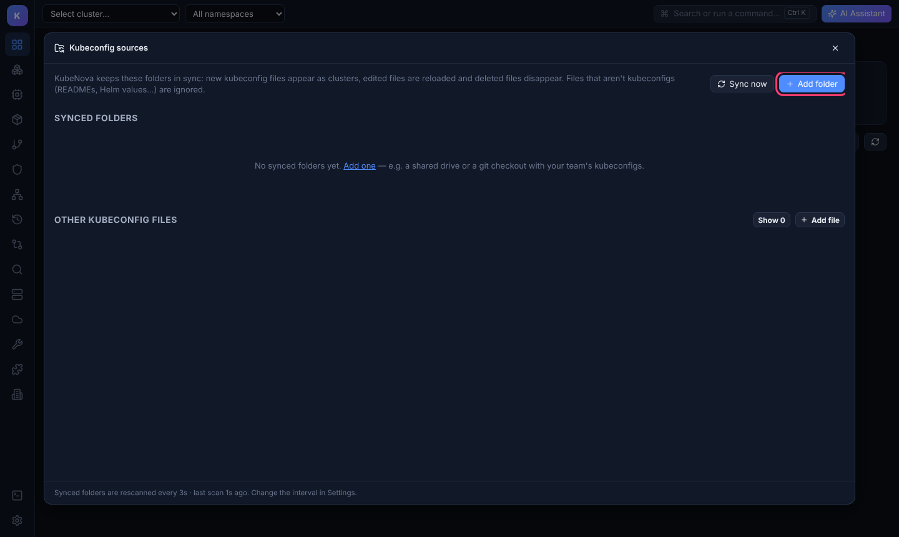
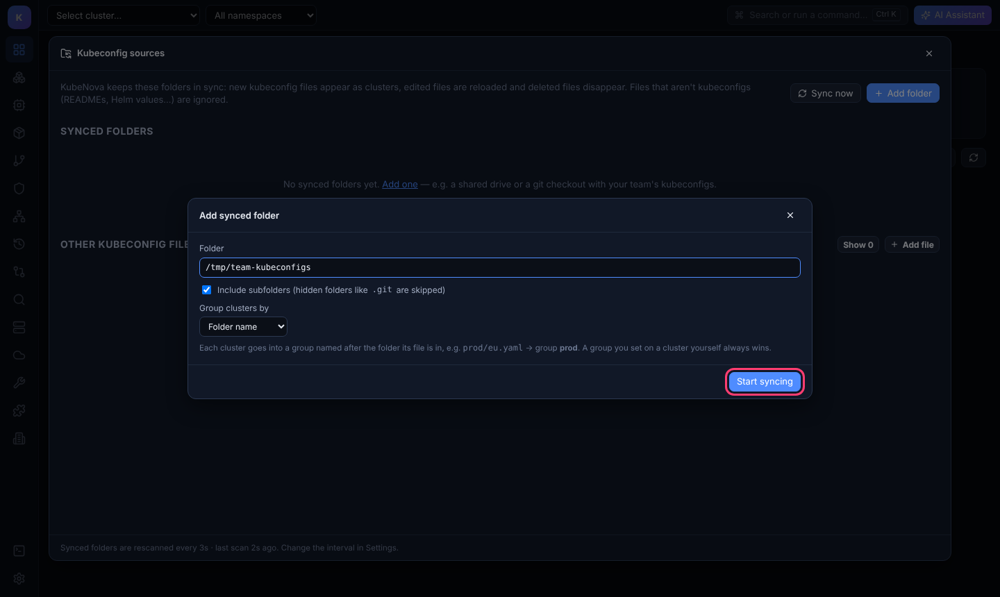
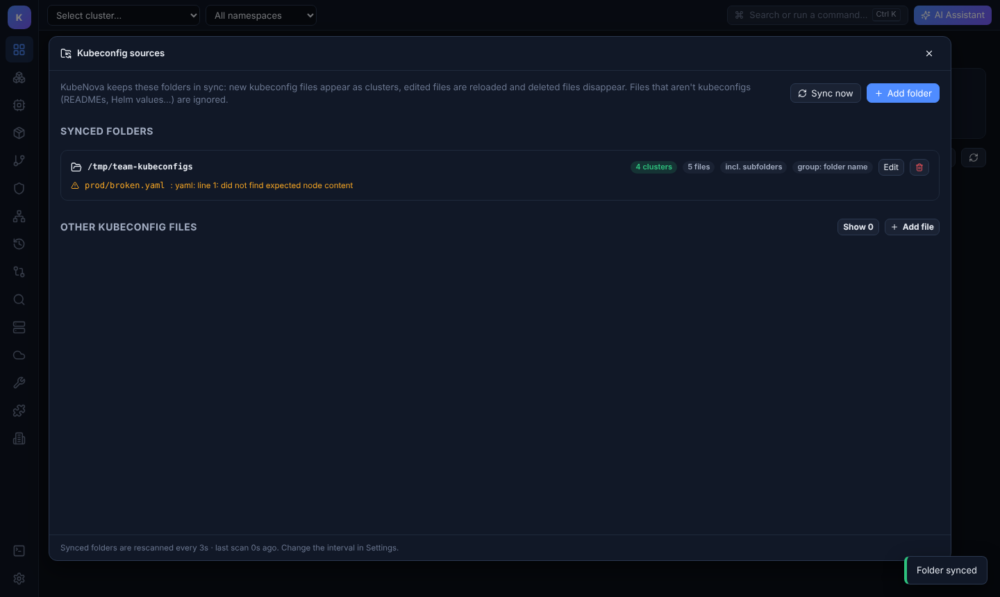
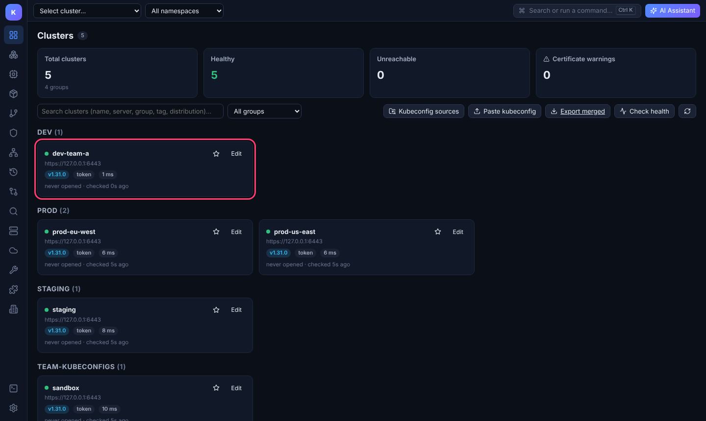

# Sync kubeconfig folders

Point KubeNova at one or more folders of kubeconfig files and it keeps them in sync while the app is running:

- **New file** → its clusters are added within a few seconds. KubeNova doesn't connect to them until you click one (see *Connections* below).
- **Edited file** (rotated token, new server address…) → reloaded; open connections switch to the new credentials.
- **Deleted file** → its clusters disappear.

No restart or manual refresh needed. This works well with a **shared network drive**, a **git checkout** of your team's kubeconfigs (`git pull` and the changes show up), or a folder synced by **OneDrive / Dropbox / Google Drive**.

## Add a folder

1. Go to **Clusters** → **Kubeconfig sources** → **Add folder**.

   

2. Pick the folder (**Browse** in the desktop app, or type the path), then choose:
   - **Include subfolders**: scan the whole tree. Hidden folders such as `.git` are skipped.
   - **Group clusters by**:
     - *Folder name* (default): each file's folder becomes its group, e.g. `prod/eu.yaml` → **prod**.
     - *Custom name*: every cluster from this folder goes into one group.
     - *No group*.

   Click **Start syncing**.

   

3. The folder is listed with its cluster and file counts. Files that look like kubeconfigs but can't be parsed are shown with the error, so a typo doesn't make a cluster silently vanish.

   

From now on, changes in the folder show up by themselves. In this example `dev/dev-team-a.yaml` was copied into the folder while KubeNova was open:

## What gets read

- Files with no extension or ending in `.yaml`, `.yml`, `.conf`, `.config`, `.kubeconfig` or `.json`, up to 5 MB.
- YAML/JSON files that aren't kubeconfigs (Helm values, manifests…) and other files like `README.md` are ignored.
- Each context in a file becomes one cluster. A file can contain many contexts.

`~/.kube/config`, every file in `~/.kube/configs/`, and the files listed in `$KUBECONFIG` are always loaded and also kept in sync, without any setup.

## Good to know

- **Your own settings win.** If you rename a cluster, set its group, star it or tag it, that sticks even when the file is updated.
- **Stopping sync** (bin icon) removes the folder's clusters from KubeNova; the files on disk are never touched or deleted.
- **Removing one cluster** that comes from a synced folder: delete or move its file. KubeNova won't hide individual files from a synced folder, because they'd come back on the next scan.
- **Interval:** folders are rescanned every 3 seconds by default; change it in **Settings → Kubeconfig folder sync interval**. Rescans only compare file sizes and modification times, so they stay cheap even with hundreds of files.
- **Sync now** forces an immediate rescan.

## Connections

Adding a cluster never connects to it. KubeNova only talks to clusters you **open** (click) during the session; others show **not connected**, so a folder with 200 kubeconfigs doesn't trigger 200 logins (OIDC, AWS SSO, `gcloud`…) or slow anything down.

- **Disconnect** on a cluster card stops the background checks for it.
- **Check all now** contacts every cluster once, on demand.
- **Settings → Which clusters KubeNova contacts in the background** changes this: *Only clusters I open* (default), *All clusters* (the old behaviour), or *None*.

## API

| Method | Path | Body / query |
|---|---|---|
| `GET` | `/api/kubeconfigs` | status of every folder and file |
| `POST` | `/api/kubeconfigs/dirs` | `{"path": "/kubeconfigs", "recursive": true, "group": "@folder"}` (`group`: `@folder`, any name, or empty) |
| `DELETE` | `/api/kubeconfigs/dirs?path=/kubeconfigs` | stop syncing |
| `POST` | `/api/kubeconfigs/sync` | rescan now |
| `GET` (WebSocket) | `/api/events` | sends `{"type":"clusters"}` whenever the cluster list changes |
