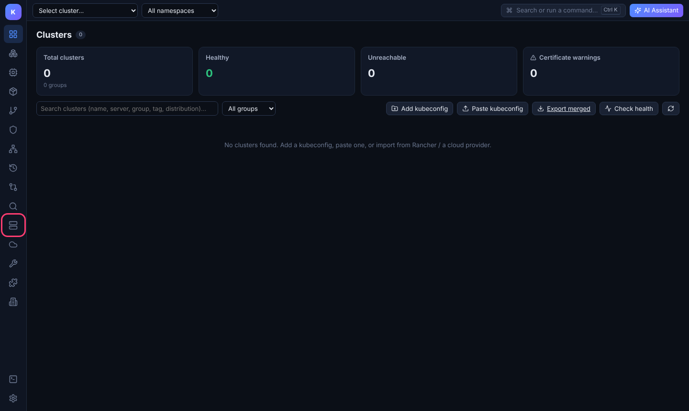
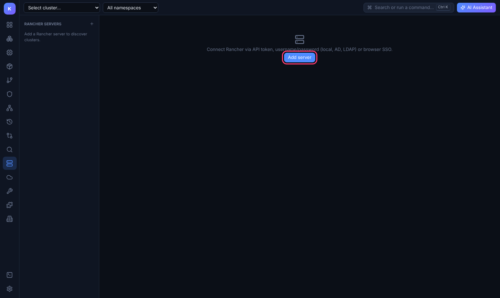
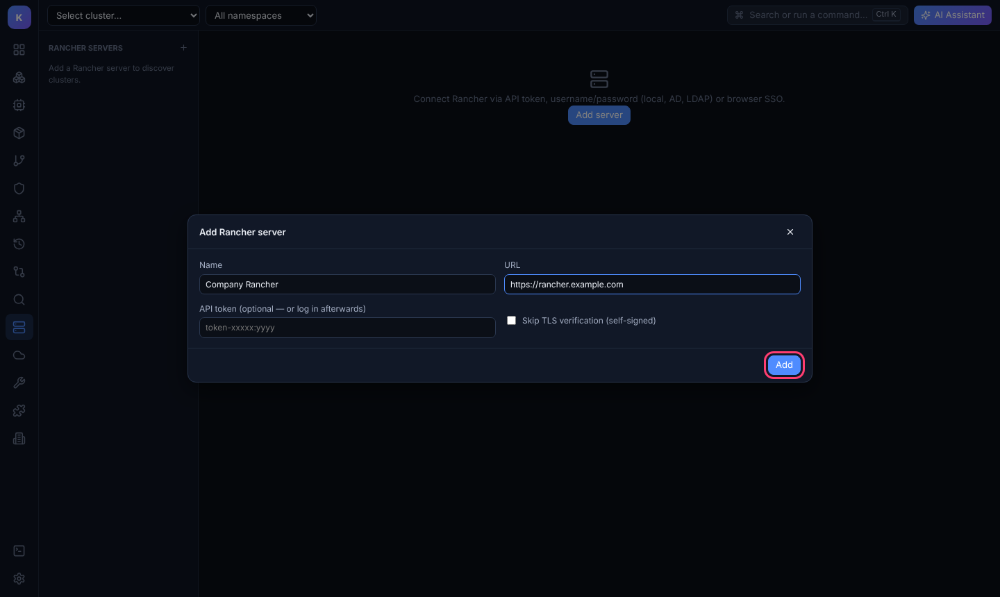
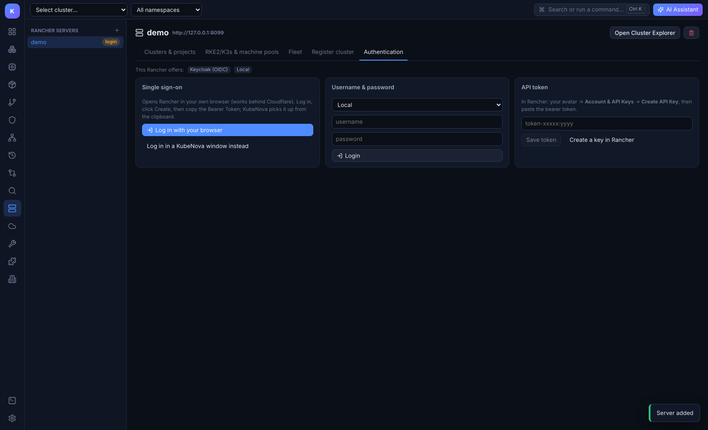
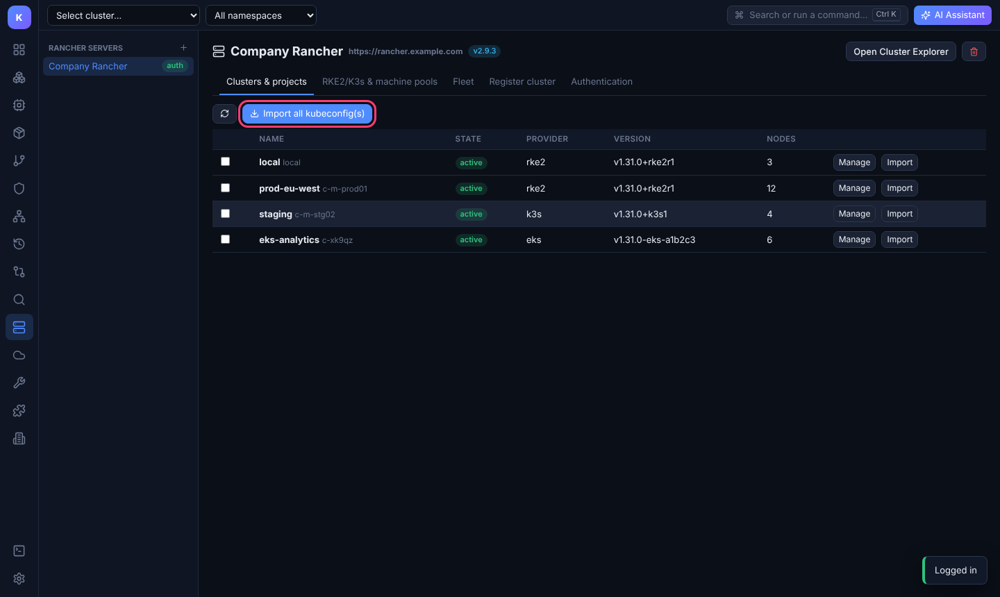
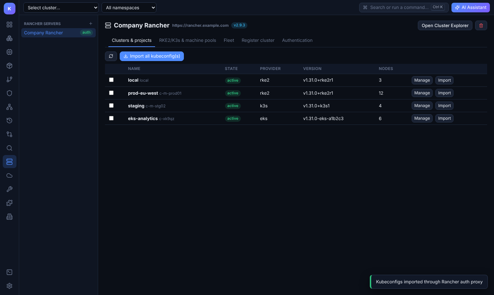
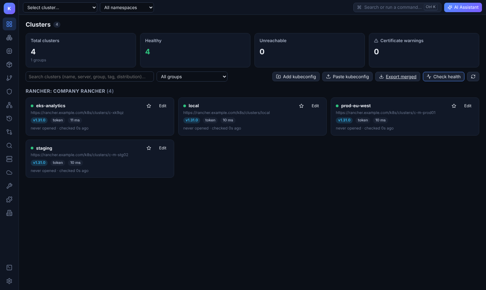
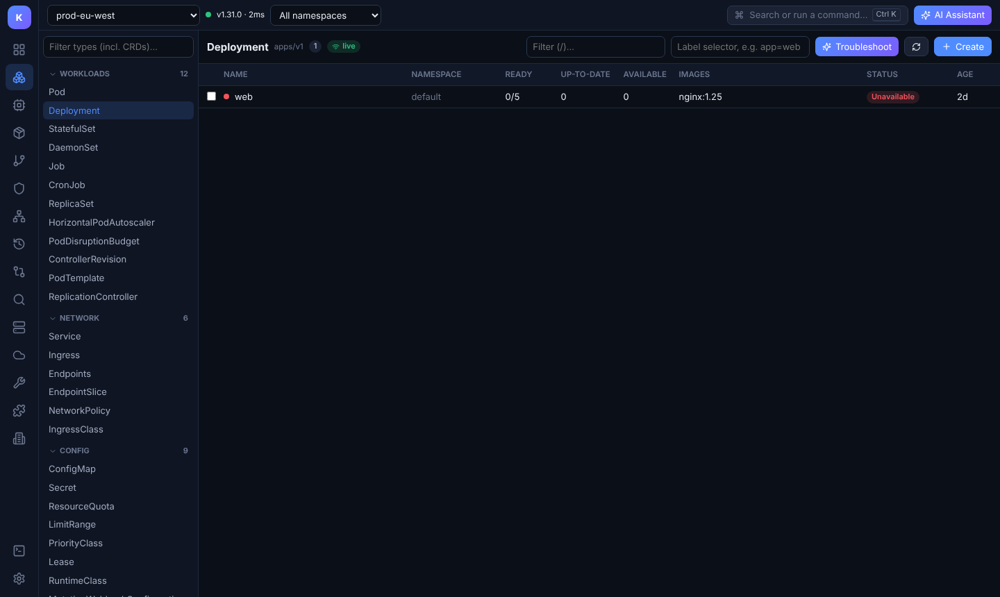
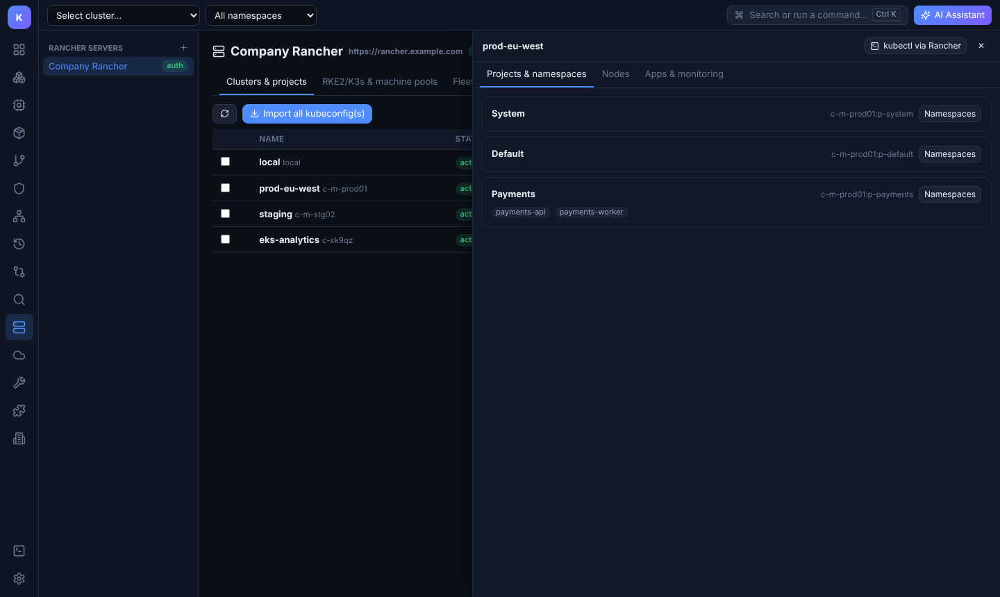
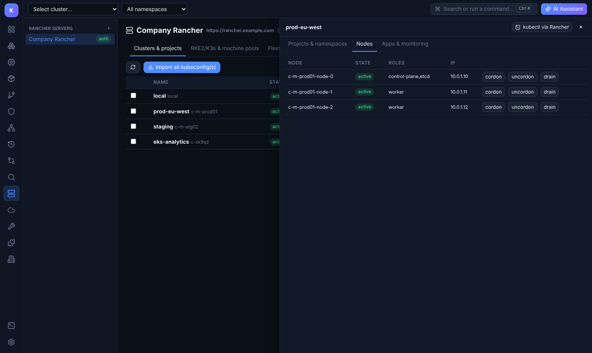

# Import all your clusters from Rancher

KubeNova connects to the Rancher API, lists every cluster Rancher manages (RKE2, K3s, imported, EKS/AKS/GKE), and imports a kubeconfig for each one. The imported kubeconfigs go through **Rancher's authentication proxy** (`https://<rancher>/k8s/clusters/<id>`). Your Rancher permissions and projects keep applying, and you don't need direct network access to each cluster's API server.

> The screenshots use the example server `https://rancher.example.com`. Use your own Rancher URL.

## Before you start

You need:

- The Rancher URL, e.g. `https://rancher.mycompany.com`.
- One way to log in: a **Rancher API token**, a **username/password** (local, Active Directory, OpenLDAP or FreeIPA), or **SSO** (Azure AD, Okta, Keycloak, GitHub, SAML or OIDC, whatever your Rancher is set up for).

**Optional: create an API token in Rancher.** In the Rancher UI, click your avatar (top right) → **Account & API Keys** → **Create API Key**. Pick a scope of *No Scope* and an expiry, then copy the **Bearer Token** (`token-xxxxx:yyyy…`). Rancher shows it only once.

---

## Step 1: Open the Rancher page

Click the **Rancher** icon in the left sidebar.

## Step 2: Add your Rancher server

Click **Add server**.

Enter a **name** (it becomes the group name for the imported clusters) and the **Rancher URL**. If you already have an API token, paste it here and you can skip Step 3. Click **Add**.

> Only tick **Skip TLS verification** if your Rancher uses a self-signed certificate and you can't install its CA on your machine. Installing the CA is the safer option.

## Step 3: Log in

The server now shows a yellow **login** badge. The **Authentication** tab shows which login providers your Rancher has, and offers three ways in:

| Option | Use it when |
|---|---|
| **Username & password** | You log in to Rancher with a local, Active Directory, OpenLDAP or FreeIPA account. Pick the provider from the drop-down. |
| **API token** | You created a token in Rancher (see "Before you start"). |
| **Single sign-on** | Your Rancher uses Keycloak, Okta, Azure AD, GitHub, Google, SAML, OIDC or any other provider. Click **Log in with your browser**: Rancher's *Create API Key* page opens in your normal browser, so Cloudflare and other "verify you are human" checks work. Log in, click **Create**, then click the copy button next to **Bearer Token**. KubeNova picks the token up from the clipboard by itself (copying the access key and then the secret key works too). If your Rancher only uses SAML, the browser login is fully automatic and no key is needed. |

After a successful login, the badge turns green (**auth**).

> **Why do I create an API key?** Rancher can hand a browser login back to an app only for SAML providers. With OIDC (Keycloak OIDC, Okta OIDC, GitHub, Google…) you can log in in the browser, but Rancher never passes the session to the app. An API key is Rancher's supported way for tools to log in. In Rancher you can give it an expiry date, and you can delete it any time under **Account & API Keys**.
>
> **Log in in a KubeNova window instead** opens Rancher's login page inside KubeNova and needs no key. It does not work when Cloudflare, or another bot check, blocks embedded browsers.

## Step 4: Import all kubeconfigs

The **Clusters & projects** tab lists every cluster you can see in Rancher, with its state, distribution, Kubernetes version and node count.

- Click **Import all kubeconfig(s)** to import every cluster at once.
- To import only some clusters, tick their checkboxes first (the button changes to **Import N kubeconfig(s)**), or use the **Import** button on a single row.

KubeNova confirms the import:

## Step 5: Use the clusters

Open **Clusters** in the left sidebar. The imported clusters appear in a group named **Rancher: \<server name\>**. Their API addresses point at Rancher's proxy (`…/k8s/clusters/<id>`).

KubeNova **doesn't connect to any of them yet**: each one shows **not connected**. Click the cluster you want to work with and KubeNova connects to that one only (green dot, version and latency appear). **Disconnect** stops all traffic to it again. **Check all now** contacts every cluster once if you want a status overview.

Click any cluster to start working with it: workloads, logs, shell, YAML, Helm, GitOps, the AI assistant and the rest.

## Extra: projects, namespaces and nodes

On the Rancher page, click **Manage** on a cluster:

- **Projects & namespaces** lists Rancher projects. Click **Namespaces** to see which namespaces belong to a project, then click a namespace to jump to it in the resource explorer.
- **Nodes** lists the cluster's nodes, with **cordon**, **uncordon** and **drain** buttons.
- **Apps & monitoring** lists the apps installed from Rancher's catalog.
- **kubectl via Rancher** opens a terminal with `KUBECONFIG` set to that cluster (shown once the cluster is imported).

The other tabs on the server page cover **RKE2/K3s & machine pools** (scale pools, upgrade Kubernetes), **Fleet** (git repos and bundles) and **Register cluster** (create an imported cluster and get its registration command).

---

## Keeping in sync

- **New clusters in Rancher:** click **Import all kubeconfig(s)** again. Clusters you already imported are updated in place, not duplicated.
- **Token expired:** log in again on the **Authentication** tab, then import again. The imported kubeconfigs contain your Rancher token, so they stop working when it expires.
- **Several Rancher servers:** add each one with **+** next to *Rancher servers*. Each server gets its own group in the cluster list.
- **Removing:** delete a cluster's kubeconfig from **Clusters → Edit → Remove source**, or remove the whole server with the bin icon on the server page.

## Where things are stored

| What | Where |
|---|---|
| Rancher servers and tokens | `<data dir>/rancher/servers.json` (file mode 0600) |
| Imported kubeconfigs | `<data dir>/kubeconfigs/rancher-<server>-<cluster id>.yaml` |

The data dir is `~/.config/KubeNova` on Linux, `~/Library/Application Support/KubeNova` on macOS, and `%APPDATA%\KubeNova` on Windows. The imported files are ordinary kubeconfigs, so `kubectl --kubeconfig <file>` works with them too.

## Troubleshooting

| Problem | Fix |
|---|---|
| `x509: certificate signed by unknown authority` | Install your Rancher CA on the machine (recommended), or edit the server and tick *Skip TLS verification*. |
| Login works in the browser but not in KubeNova | Corporate proxy: set it in **Settings → Network → HTTP(S) proxy**. |
| `401 Unauthorized` when listing clusters | The token expired or was revoked. Log in again. |
| A cluster shows *unreachable* after import | The cluster itself is down or disconnected from Rancher (check its state in Rancher). |
| "Waiting for browser login…" never finishes | You're on an old version, or running KubeNova in a plain browser (not the desktop app) with an OIDC provider. Use **Log in with Rancher** in the desktop app, or paste an API token. |
| The KubeNova login window shows a Cloudflare "verify you are human" loop, or an "embedded browsers" error | Use **Log in with your browser**. |
| KubeNova doesn't pick up the copied key | Copy the **Bearer Token** (not only the access key), or paste it under **API token**. KubeNova watches the clipboard for 15 minutes after you click the button. |
